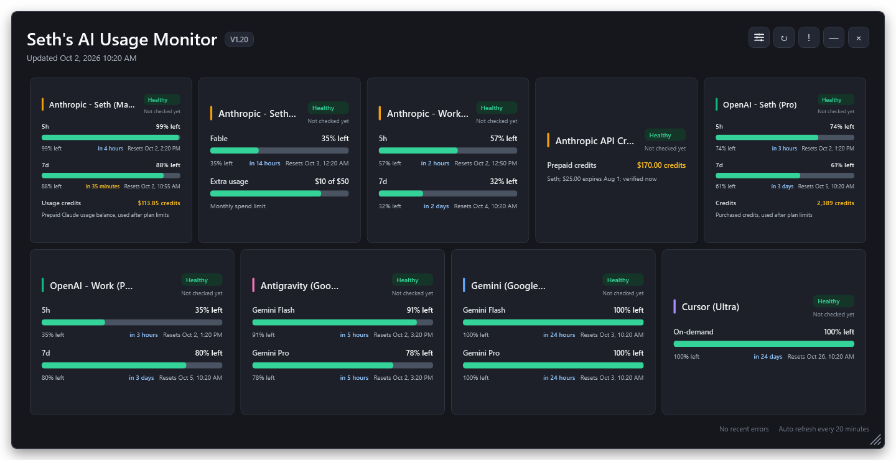
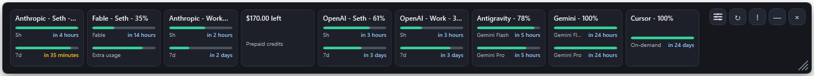
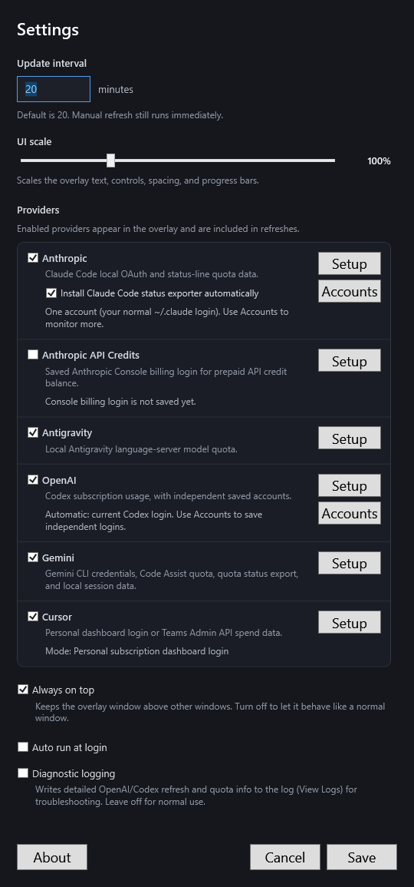
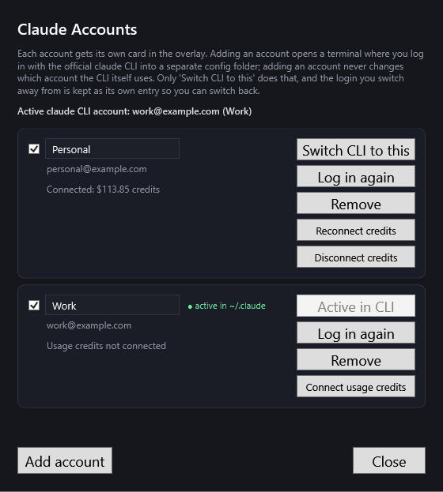
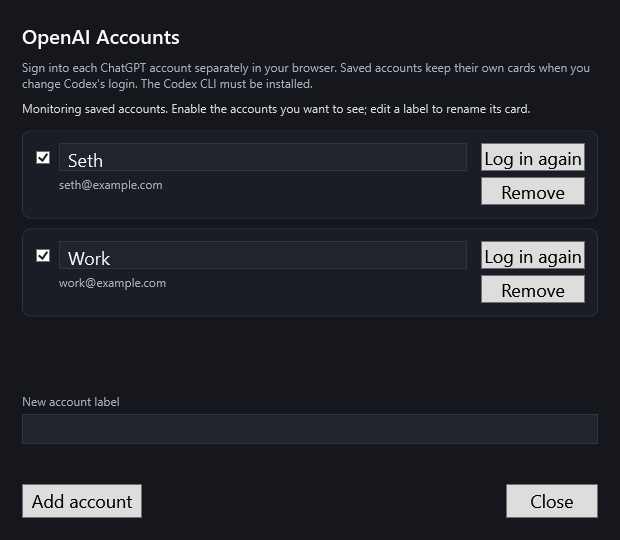

# Seth's AI Usage Monitor

The overlay changes content density as you resize it instead of simply shrinking the same layout.

Settings let you pick the refresh interval, UI scale, which providers appear, whether the overlay stays always-on-top, and more:

Monitor multiple Claude accounts side by side, each with its own overlay card, and switch which account the claude CLI uses with one click:

Save multiple OpenAI accounts and monitor them independently of the login currently used by Codex:

# Download #

Current version: V1.17, latest updated August 22, 2026.

**[Download for Windows - Code signed by me, Seth A. Robinson](https://rtsoft.com/files/SethsAIUsageMonitor-win-x64.zip)**

# Info #

Windows tray app for checking remaining AI subscription usage across Anthropic, OpenAI/Codex, Antigravity, Gemini, and Cursor.

Warning: refreshing stale Anthropic data or automatic OpenAI data may run a tiny CLI probe, which can consume a small amount of your plan usage. Saved OpenAI accounts read quota directly through Codex account requests without sending a model prompt.

This is app was stupid easy to make, so you have a need for it, you undoubtely can just have AI make your own.  Even so, I like to put things like this on Github though to stay organized and have reliable source backups.

- Always-on-top overlay with percentage remaining, reset times, plan names, and per-provider last checked status.
- Supports Anthropic, OpenAI/Codex, Antigravity, Gemini, and Cursor local usage checks.
- Multiple Claude accounts: add extra accounts in Settings (each logs in with the official claude CLI into its own config folder), monitor them side by side, and switch which account the claude CLI uses with one click.
- Multiple OpenAI accounts: save separate ChatGPT logins in Settings > OpenAI > Accounts. Each account has its own label and quota card, even when you change the login used by Codex.
- Small grouped cards keep their account labels, such as `Fable - Seth - 35%`.
- Tray controls for show/hide, refresh now, settings, logs, and exit.
- Layout adjusts as you drag the size to fit more or less info, UI scale slider in its Settings
- Provider errors go to copyable logs and use backoff to avoid hammering services.
- Build from VS Code with `dotnet build`; run with `dotnet run --project AIUsageMonitor.csproj`.
- Build a standalone Windows x64 zip with `package-release.bat`.

Requires Windows and the .NET 10 SDK for development.

## Set up multiple OpenAI accounts

1. Install the [Codex CLI](https://developers.openai.com/codex/quickstart).
2. Open **Settings > OpenAI > Accounts**, enter a label such as **Seth** or **Work**, and select **Add account**.
3. Complete the OpenAI browser login for that account. Repeat for every account you want to monitor.

The first successful saved login replaces the automatic OpenAI card. Each saved account stays fixed when you sign into a different account in Codex. Rename labels, enable or disable cards, remove saved accounts, or use **Log in again** from this dialog. Signing into a different account during re-login preserves the original login; use **Add account** instead. Disabling or removing every saved account leaves no OpenAI cards until you enable or add one.

Saved logins live under `%LOCALAPPDATA%\SethsAIUsageMonitor\accounts\openai`, with a separate Codex home per account. Codex handles token renewal. The monitor does not switch the login in your Codex CLI or desktop app. A current Codex CLI with the account app-server API is required; the desktop app alone is insufficient for saved accounts.

Developer details and fake-test coverage: [OpenAI account architecture](docs/openai-accounts.md).

## AI Disclosure

This project was developed with significant assistance from AI tools.  I mean, you can still blame me (Seth) for bugs, but I just wanted to mention it.

## Credits

Created by Seth A. Robinson - [Homepage](https://www.rtsoft.com/) | [Blog](https://www.codedojo.com/) | [Twitter](https://twitter.com/rtsoft) | [Bluesky](https://bsky.app/profile/rtsoft.com) | [Mastodon](https://mastodon.gamedev.place/@rtsoft)
